# Каталог елементів і субтитрів для сценарію кадру

Сценарій пишеться кодами: «3.2 с: **E01** (лічильник 0→100), 8.0 с: **H01** (стрілка на голову)», субтитри: `cap: 'S02+T04+T27+T36+T47'`.
Елементи: групи A–J. Субтитри: S = стиль, T = поява/поведінка/зникнення/позиція. Усі 100 елементів і 50 кодів субтитрів є в коді (`motion/Elements.tsx` + `motion/el/*.tsx`, `motion/Text.tsx`). **Скріншоти з кодами: `docs/elements/A.jpg … J.jpg`, `docs/elements/captions.jpg`** — дивись їх перед сценарієм.

**Як вставити в edit.json.** Елемент = запис у `cards`: `{"at": 12.3, "dur": 3, "type": "E01", ...поля}` (`at` у секундах вихідного відео; `side` left/right/center, `y`, `scale` — як у старих картках). Поля кожного коду — у реєстрі групи `motion/el/<A…J>.tsx` (хвиля 1 — у `motion/Elements.tsx`), поле `demo` = робочий приклад. Старі імена `crumbs/skill/list/stack/chat` = A01/B01/F01/F02/C01, обидва записи працюють. Субтитри: `"captions": {"cap": "S02+T04+T27+T36"}`; вісь без коду лишається як було (S01/S02 з `captions.style`, поява T01). Використані коди `vid.mjs` пише в `work/<назва>/codes.txt`: перед новим сценарієм глянь 2–3 попередні й не повторюй набір. **Колір і розмір:** `scale` (розмір), `side`/`y` (місце), `accent: "#FFD84D"` і `theme: "glow"` на окрему картку; без них усі картки беруть `theme.accent` ролику. Субтитри: `captions.size` (множник, напр. 1.15). Акцент тримай яскравим (≥3:1 на темному склі, бо на заливці акцентом текст темний).

**Подивитись очима:** аркуші в `docs/elements/`; відео: `node node_modules/@remotion/cli/remotion-cli.js render motion/index.ts Catalog <out>.mp4 --scale=0.5 --concurrency=4` (усі 100, кожен 3.5 с + 1.2 с паузи) або `Catalog-A … Catalog-J` (по групі), `CapCatalog` (40 комбінацій субтитрів). Перезняти аркуші: `node scripts/catalog-stills.mjs`.

**Обмеження шару-накладки** (він прозорий і не бачить відео під собою): H04 лупа лише малює рамку, наближення роби `zooms` на те саме місце; J03 whip-pan, J05 фриз, J06 split — накладки (смуги, спалах + рамка, лінія), без справжнього розмиття/заморожування; T44 «з-за спини» тут підіймається з-під рядка, справжня маска спікера лише у broll. B05 ціни, I05 коментарі, E-цифри — тільки реальні дані.

Правила для всіх: графіт + лайм #C3FF55, без червоного на синьому (контраст ≥3:1), safe-зона x 84..940 / y 180..1650, картки збоку від спікера, SFX лише на появу елемента, анімація тільки від кадру. На 30 с ролика не менше 4 різних кодів, один код не частіше разу на ролик (крім J01).

## 100 елементів

### A. Навігація й інтерфейс (де клікати)
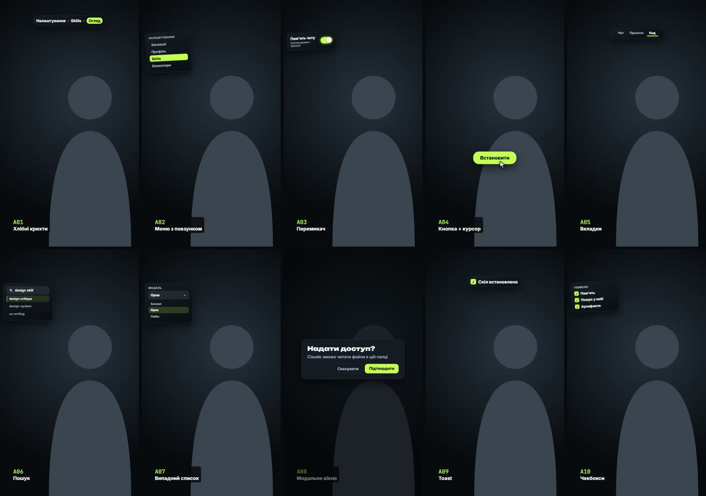

| Код | Елемент | Як з'являється | Коли брати |
|---|---|---|---|
| A01 ✅ | Хлібні крихти (Профіль › План › Pro) | виїзд згори, крок підсвічується за `marks` | шлях у налаштуваннях |
| A02 ✅ | Вертикальне меню з повзунком-підсвіткою | меню виїжджає, лаймова плашка сповзає на потрібний пункт | «зайди в розділ X» |
| A03 ✅ | Перемикач (toggle) off→on | картка з тумблером, клац із пружиною й лаймовим заповненням | «увімкни функцію» |
| A04 ✅ | Кнопка + курсор-клік | курсор долітає по дузі, кнопка тисне, хвиля | «натисни кнопку» |
| A05 ✅ | Вкладки (tabs) | ряд вкладок, підкреслення перебігає | вибір режиму |
| A06 ✅ | Поле пошуку, що само друкує | рядок друкується, під ним випадає 3 підказки | «знайди в пошуку» |
| A07 ✅ | Випадний список (dropdown) | розкривається, обраний пункт мигає лаймом | вибір моделі/тарифу |
| A08 ✅ | Модальне вікно «Підтвердити» | масштаб 0.9→1 із затемненням навколо | попередження, підтвердження |
| A09 ✅ | Toast-сповіщення «Готово ✓» | заїжджає знизу/згори й зникає за 1.5 с | результат дії |
| A10 ✅ | Чекбокси-налаштування | ставляться галочки одна за одною | «увімкни ось ці 3 пункти» |

### B. Картки й вікна (що це за штука)
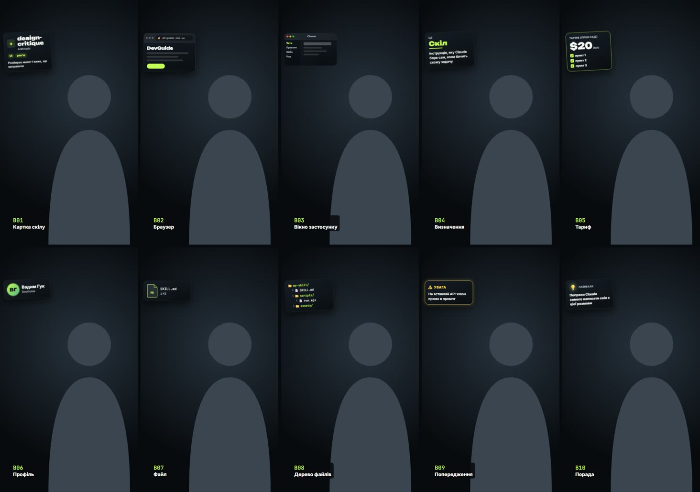

| Код | Елемент | Як з'являється | Коли брати |
|---|---|---|---|
| B01 ✅ | Картка скілу (іконка, автор, чіпи, опис) | вліт збоку з нахилом | показати інструмент |
| B02 ✅ | Вікно браузера з адресою | вікно «відкривається» з точки, адреса друкується | сайт, сервіс |
| B03 ✅ | Вікно застосунку (macOS-хром, 3 крапки) | розгортання з центру | програма, Claude Desktop |
| B04 ✅ | Картка-визначення «X — це…» | слово великим, нижче рядок пояснення проявляється | новий термін |
| B05 ✅ | Картка тарифу (ціна, 3 пункти) | ціна набирається лічильником | Free vs Pro (лише реальні ціни) |
| B06 ✅ | Картка контакту/профілю (аватар, ім'я) | аватар-кружок, потім текст | згадка людини/автора |
| B07 ✅ | Картка файлу (іконка .md/.json, назва, розмір) | падає з легким відскоком | «створи файл X» |
| B08 ✅ | Папка, що розкривається в дерево файлів | гілки виростають по черзі | структура проєкту |
| B09 ✅ | Картка-попередження (жовта рамка, ⚠) | струс 2 рази | «увага, не роби так» |
| B10 ✅ | Картка-порада (лампочка 💡) | лампочка «загоряється» сяйвом | лайфхак |

### C. AI й чат
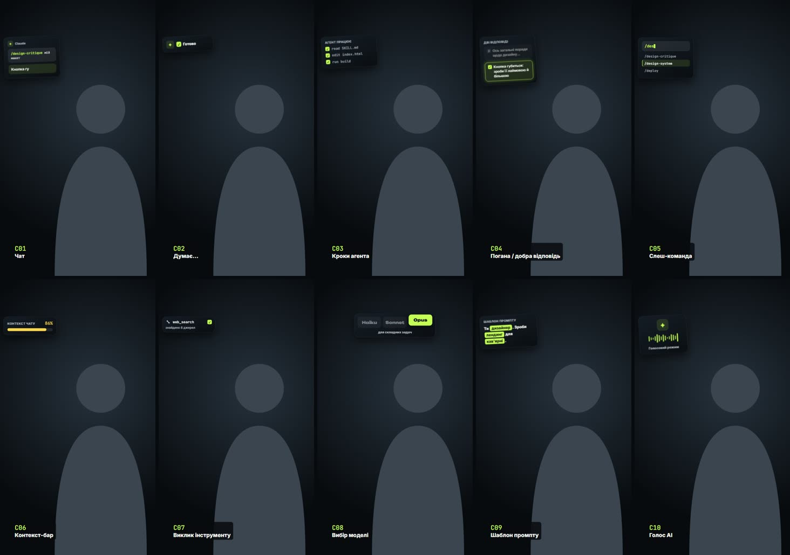

| Код | Елемент | Як з'являється | Коли брати |
|---|---|---|---|
| C01 ✅ | Чат: промпт друкується, відповідь | друк + «• • •» + відповідь | показати промпт |
| C02 ✅ | Індикатор «Claude думає…» | три крапки пульсують, потім галочка | очікування |
| C03 ✅ | Ланцюжок кроків агента (read → edit → run) | рядки з'являються з іконкою статусу, крутилка → ✓ | агент працює сам |
| C04 ✅ | Порівняння двох відповідей (погано/добре) | дві бульбашки, погана тьмяніє, добра світиться | різниця промптів |
| C05 ✅ | Слеш-команда з автопідказкою | `/` → випадає список команд, вибір | скіли, команди |
| C06 ✅ | Токен-лічильник / контекст-бар | смуга заповнюється до відсотка | ліміти контексту |
| C07 ✅ | Інструмент-виклик (tool call chip) | чіп «🔧 web_search» вспливає, крутиться, ✓ | MCP, конектори |
| C08 ✅ | Вибір моделі (Opus / Sonnet / Haiku) | три плашки, одна піднімається | яку модель брати |
| C09 ✅ | Промпт-шаблон із пропусками | порожні `[ ]` заповнюються по черзі | структура промпту |
| C10 ✅ | Аватар AI, що «говорить» хвилею | хвиля звуку під іконкою | голосовий режим |

### D. Код і термінал
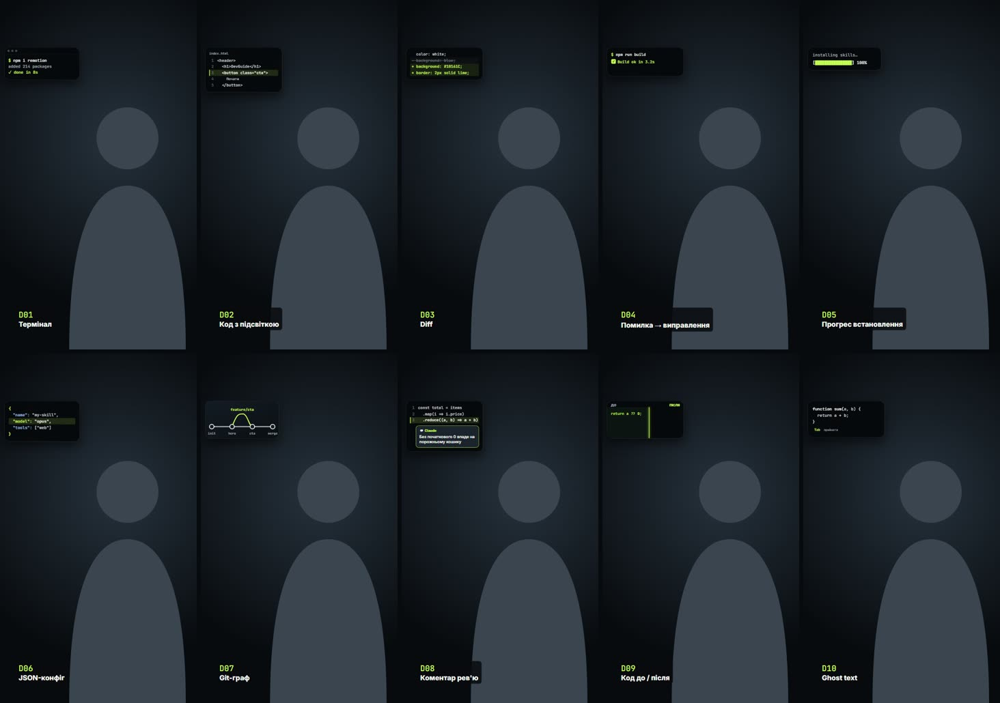

| Код | Елемент | Як з'являється | Коли брати |
|---|---|---|---|
| D01 ✅ | Термінал: команда друкується, вивід біжить | друк + рядки виводу | `npm`, `git`, встановлення |
| D02 ✅ | Фрагмент коду з підсвіткою рядка | код проявляється, рядок-маркер підсвічується | «ось тут» |
| D03 ✅ | Diff (+ зелені / − приглушені) | рядки «−» перекреслюються, «+» в'їжджають | що змінилось |
| D04 ✅ | Помилка в терміналі → виправлення | червоний рядок (на темному) → замінюється ✓ | дебаг |
| D05 ✅ | Прогрес-бар встановлення `[████░░] 64%` | заповнюється | довгий процес |
| D06 ✅ | JSON-конфіг, ключ підсвічується | дужки розкриваються | налаштування |
| D07 ✅ | Git-граф (гілки, коміт-крапки) | лінії малюються, крапки спливають | гілки, коміти |
| D08 ✅ | Code review коментар на рядку | бульбашка «пришпилюється» до рядка | рев'ю |
| D09 ✅ | Файл до/після (2 колонки) | шторка-слайдер посередині | рефакторинг |
| D10 ✅ | Курсор, що «пише» код сам (ghost text) | сірий текст стає білим | автодоповнення |

### E. Цифри й дані
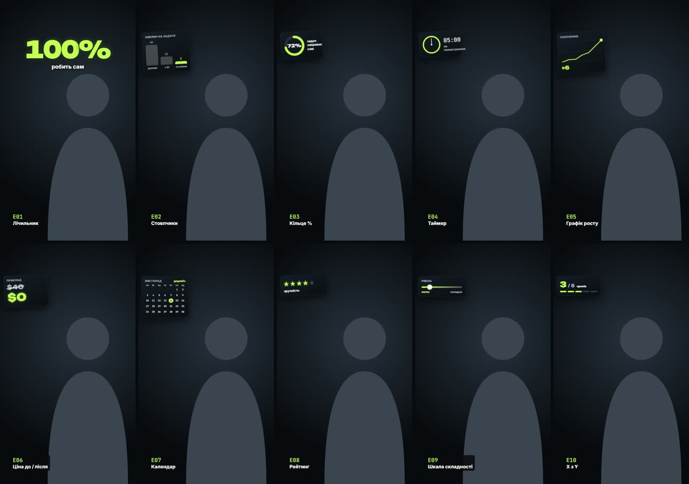

| Код | Елемент | Як з'являється | Коли брати |
|---|---|---|---|
| E01 ✅ | Великий лічильник 0 → N | цифри крутяться, фініш з поштовхом | будь-яке число |
| E02 ✅ | Стовпчики (2–4 бари) | ростуть знизу по черзі | порівняння величин |
| E03 ✅ | Кільце-прогрес (donut) | дуга замикається до % | частка, відсоток |
| E04 ✅ | Таймер / секундомір | стрілка біжить, цифри | «за 5 хвилин» |
| E05 ✅ | Лінія графіка, що росте | лінія малюється, крапка-маркер в кінці | ріст |
| E06 ✅ | Ціна до/після (перекреслена) | стара перекреслюється лінією, нова вискакує | економія |
| E07 ✅ | Календар із позначеним днем | сітка, день обводиться | дедлайн, розклад |
| E08 ✅ | Рейтинг зірками | зірки загоряються по черзі | оцінка |
| E09 ✅ | Шкала-слайдер (легко ↔ складно) | повзунок їде на позицію | рівень складності |
| E10 ✅ | Лічильник «X з Y» (3/5) | крапки-кроки заповнюються | де ми в серії |

### F. Списки й кроки
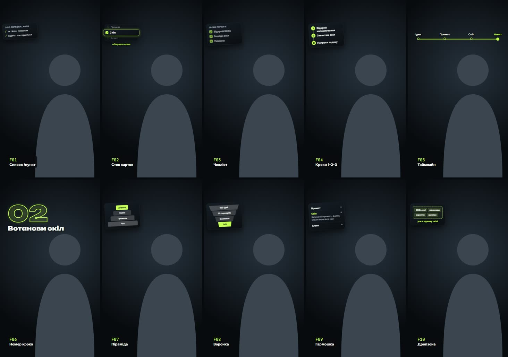

| Код | Елемент | Як з'являється | Коли брати |
|---|---|---|---|
| F01 ✅ | Список `/ пункт` (моно) | пункти вʼїжджають по черзі | перелік |
| F02 ✅ | Стек карток з активною | стос, одна піднімається з ✓ | вибір одного з кількох |
| F03 ✅ | Чекліст, що закреслюється | галочка ставиться, текст тьмяніє | «зроби по порядку» |
| F04 ✅ | Нумеровані кроки 1-2-3 вертикально | цифра-кружок, лінія тягнеться до наступного | інструкція |
| F05 ✅ | Таймлайн горизонтальний | точки на лінії, підпис над кожною | історія, етапи |
| F06 ✅ | Велика цифра кроку «02» + заголовок | цифра влітає, заголовок під нею | розділ відео |
| F07 ✅ | Піраміда / рівні | рівні складаються знизу | ієрархія |
| F08 ✅ | Воронка | смуги звужуються | процес відбору |
| F09 ✅ | Картки-гармошка (розкривається одна) | заголовки, один розкривається | «головне — ось це» |
| F10 ✅ | Кошик/«дропзона» для пунктів | пункти падають у контейнер | «зібрали все разом» |

### G. Порівняння й вибір
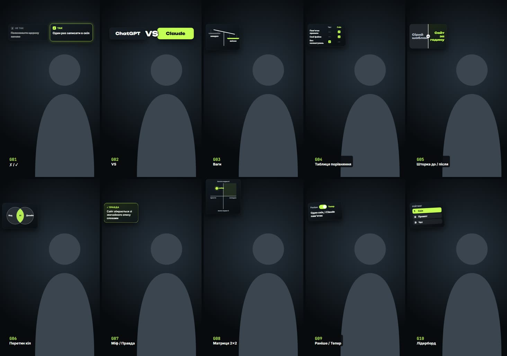

| Код | Елемент | Як з'являється | Коли брати |
|---|---|---|---|
| G01 ✅ | ✗ / ✓ дві колонки | ліва тьмяніє з ✗, права з ✓ | так/не так |
| G02 ✅ | VS-бій двох логотипів/назв | дві плашки з боків, «VS» удар посередині | X проти Y |
| G03 ✅ | Ваги (що важить більше) | чаші хитаються й зупиняються | компроміс |
| G04 ✅ | Таблиця-порівняння з галочками | рядки проявляються, галочки ставляться | фічі тарифів |
| G05 ✅ | Шторка до/після на скріні | вертикальна лінія їде | результат |
| G06 ✅ | Перетин двох кіл (Venn) | кола зʼїжджаються, перетин світиться | «на стику» |
| G07 ✅ | Міф / Правда (картка перевертається) | flip 3D | розвінчання |
| G08 ✅ | Матриця 2×2 | осі малюються, крапка ставиться в квадрант | позиціонування |
| G09 ✅ | Перемикач «Раніше / Тепер» | тумблер, контент змінюється | еволюція |
| G10 ✅ | Лідерборд (1-2-3 місце) | рядки сортуються з перестановкою | рейтинг |

### H. Акценти на кадрі й спікері
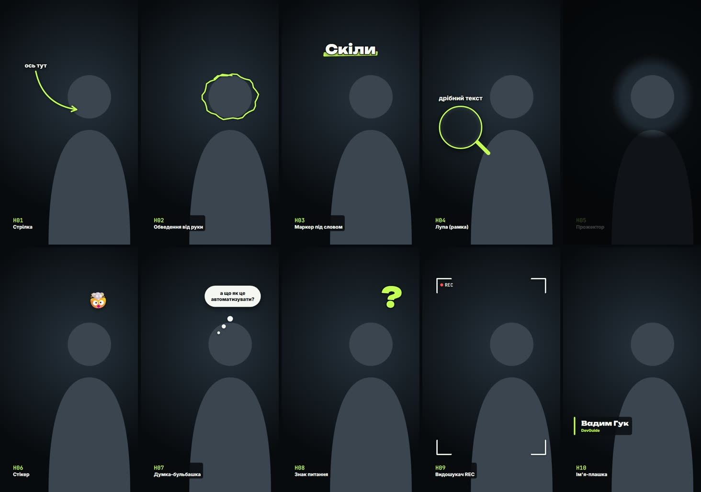

| Код | Елемент | Як з'являється | Коли брати |
|---|---|---|---|
| H01 ✅ | Мальована стрілка до спікера/обʼєкта | стрілка «малюється» штрихом | «дивись сюди» |
| H02 ✅ | Обведення від руки (коло) | контур малюється за 10 кадрів | виділити деталь |
| H03 ✅ | Маркер-підкреслення під словом-титулом | лайм-смуга росте зліва | ключове слово |
| H04 ✅ | Лупа (zoom-коло) на частину скріну | коло з 2× наближенням | дрібний текст на екрані |
| H05 ✅ | Прожектор (все темне, одна зона світла) | затемнення + світла пляма | фокус на кнопці |
| H06 ✅ | Емодзі-стікер біля голови (🤯 💡 🔥) | поп із поворотом | емоція |
| H07 ✅ | «Думка-бульбашка» над головою | кружечки ростуть до хмарки | «я подумав…» |
| H08 ✅ | Знак питання / оклику, що підстрибує | падає й відскакує | питання глядачу |
| H09 ✅ | Рамка-видошукач (кути камери REC) | кути з'їжджаються до центру | «зараз покажу» |
| H10 ✅ | Ім'я-плашка (lower third) | смуга виїжджає, ім'я друкується | хто говорить |

### I. Соцмережі й залучення
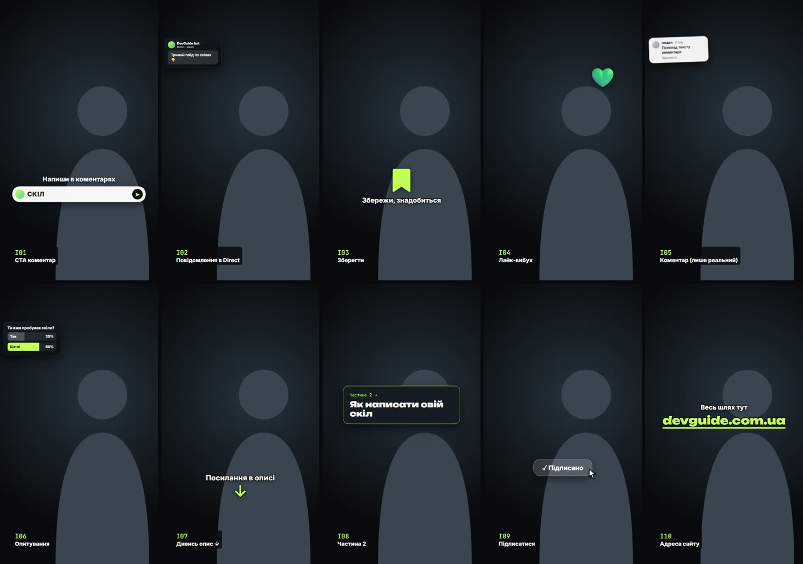

| Код | Елемент | Як з'являється | Коли брати |
|---|---|---|---|
| I01 ✅ | «Напиши СЛОВО в коментарях» з полем коментаря | поле, слово друкується, кнопка ▶ | CTA Instagram |
| I02 ✅ | Бульбашка Direct від бота | повідомлення приходить зі звуком | «бот надішле» |
| I03 ✅ | Кнопка «Зберегти» 🔖, що натискається | клік + заповнення | «збережи, знадобиться» |
| I04 ✅ | Серце-лайк, що лопає частинками | поп + 8 частинок (seeded) | реакція |
| I05 ✅ | Коментар глядача (вигаданий не можна → лише реальний) | картка коментаря вспливає | відповідь на питання |
| I06 ✅ | Опитування з 2 варіантами | смуги % заповнюються | залучення |
| I07 ✅ | Стрілка «дивись опис ↓» / «посилання в профілі» | пульсує | перенаправлення |
| I08 ✅ | «Частина 2» тизер-плашка | слайд вбік, як наступна сторінка | серія |
| I09 ✅ | Підписатись — кнопка з рукою-курсором | клік, кнопка стає «✓ Підписано» | кінець |
| I10 ✅ | QR / адреса devguide.com.ua великим | друк адреси, підкреслення | перехід на сайт |

### J. Ритм і переходи (без тексту або майже)
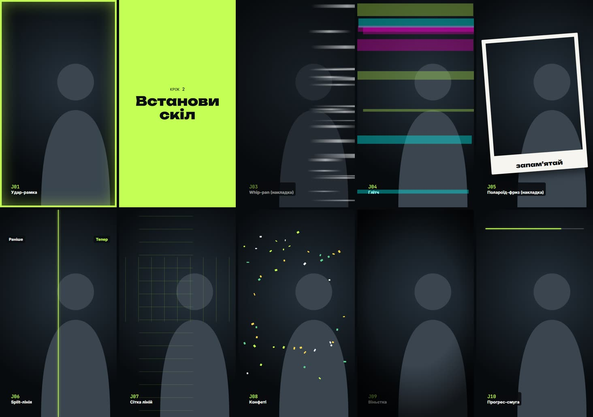

| Код | Елемент | Як з'являється | Коли брати |
|---|---|---|---|
| J01 ✅ | Удар-рамка по краях (hit) | спалах inset-рамки | склейка, акцент |
| J02 ✅ | Розділювач-глава «Крок 2» на весь кадр | шторка лаймом через екран 0.6 с | зміна теми |
| J03 ✅ | Whip-pan розмиття між сценами | горизонтальний motion blur | швидкий перехід |
| J04 ✅ | Глітч на 4 кадри | RGB-зсув, seeded | «зламалось» |
| J05 ✅ | Фриз-кадр із рамкою-полароїдом | кадр «фотографується», білий спалах | «запамʼятай момент» |
| J06 ✅ | Split-screen 2 спікери/2 екрани | кадр розʼїжджається на дві половини | паралельно |
| J07 ✅ | Сітка лаймових ліній, що пробігає | лінії перетинають кадр | технічний вайб |
| J08 ✅ | Конфеті з частинок (seeded) | вибух угорі | успіх, фінал |
| J09 ✅ | Віньєтка-фокус (м'яке затемнення країв) | за 10 кадрів, без плашки під текстом | серйозний момент |
| J10 ✅ | Прогрес-смуга відео зверху ✅ | безперервно | довгі ролики |

---

## 50 субтитрів (білий текст, різна поява)
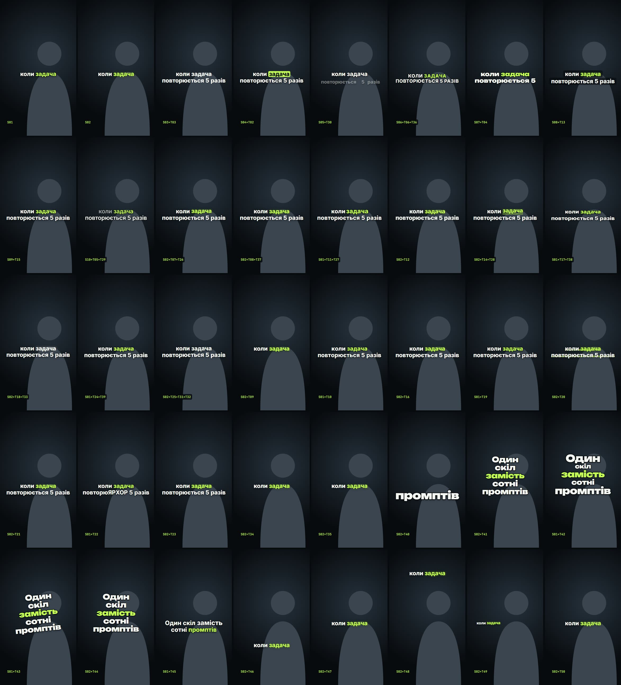

Спільне: Inter 800, білий `#F5F7F2`, 66–86 px, ≤2 рядки, сторінками (як зараз `paginate`). Пословний режим лише для T40–T45 і лише на слоганах 3–6 слів (правило автора).

### Стиль (як виглядає)
| Код | Стиль |
|---|---|
| S01 ✅ | Обводка темна + тінь (`stroke`) |
| S02 ✅ | М'яка багатошарова тінь, активне слово лаймом (`soft`) |
| S03 ✅ | Чисто білий, без підсвітки, тінь мінімальна |
| S04 ✅ | Активне слово в лаймовій плашці, текст чорний на ній |
| S05 ✅ | Минулі слова білі, майбутні 40% прозорості (караоке-шлейф) |
| S06 ✅ | Усі великими літерами, трекінг +4% |
| S07 ✅ | Unbounded 900 для рядка, Inter для решти (заголовковий) |
| S08 ✅ | Білий текст на напівпрозорій темній «таблетці» на рядок |
| S09 ✅ | Ключове слово (з `*зірочок*`) лаймом і +12% розміру |
| S10 ✅ | Курсив-акцент: ключове слово жирніше, решта 600 |

### Поява сторінки/рядка (як з'являється)
| Код | Поява |
|---|---|
| T01 ✅ | Пословний поп від базової лінії (поточний) |
| T02 ✅ | Fade-up усього рядка разом (8 кадрів) |
| T03 ✅ | Fade без руху (найспокійніше) |
| T04 ✅ | Масштаб 0.92 → 1 із пружиною, рядок цілком |
| T05 ✅ | Розмиття → різкість (blur 12 → 0) |
| T06 ✅ | Виїзд знизу з маскою (текст «виходить з-під лінії») |
| T07 ✅ | Виїзд згори з маскою |
| T08 ✅ | Слайд зліва (рядок 1) і справа (рядок 2) |
| T09 ✅ | Друкарська машинка по літерах + курсор `▍` |
| T10 ✅ | Літери розсипом (seeded зсув) збираються в слово |
| T11 ✅ | Розсування трекінгу: літери з +30% до норми |
| T12 ✅ | Поворот по осі X (flip-in, як табло) |
| T13 ✅ | Wipe зліва направо (clip-path) |
| T14 ✅ | Wipe від центру в боки |
| T15 ✅ | Рядок 1, потім рядок 2 із затримкою 6 кадрів |
| T16 ✅ | Лаймова смуга пробігає, за нею лишається текст |
| T17 ✅ | Висота «пружинить» (scaleY 0 → 1.1 → 1) |
| T18 ✅ | М'який «відскок» униз (drop + bounce) |
| T19 ✅ | Glitch-поява на 3 кадри, далі статика |
| T20 ✅ | Підсвітка-маркер під рядком, текст проявляється за нею |
| T21 ✅ | Шторка з чорного блоку, що відʼїжджає (reveal box) |
| T22 ✅ | Скремблінг символів → правильне слово (seeded) |
| T23 ✅ | Кожне слово зі свого боку (парні зліва, непарні справа), рядок цілком за 6 кадрів |
| T24 ✅ | Zoom-out із 1.4 і прозорості (ефект «наїзду») |
| T25 ✅ | Fade-in + легке хитання (±2°) один раз |

### Поведінка всередині сторінки (що відбувається, поки звучить)
| Код | Поведінка |
|---|---|
| T26 ✅ | Активне слово злегка піднімається на 6 px |
| T27 ✅ | Активне слово пульсує масштабом 1 → 1.06 |
| T28 ✅ | Підкреслення біжить під активним словом |
| T29 ✅ | Сказані слова тьмяніють до 60% |
| T30 ✅ | Нічого (статична сторінка, найчитабельніше) |
| T31 ✅ | Ключове слово на мить стає лаймовим і повертається білим |
| T32 ✅ | Повільний drift рядка вгору на 10 px за сторінку |
| T33 ✅ | Тінь-сяйво під активним словом (без кольору тексту) |
| T34 ✅ | Емодзі після ключового слова (з мапи слів), поп |
| T35 ✅ | Числа в тексті підсвічуються й «докручуються» лічильником |

### Зникнення
| Код | Зникнення |
|---|---|
| T36 ✅ | Fade-out 5 кадрів |
| T37 ✅ | Виїзд угору + fade (наступна сторінка знизу) |
| T38 ✅ | Стиснення по Y до 0 |
| T39 ✅ | Розмиття → зникнення |

### Пословні / слоганові (тільки 3–6 слів)
| Код | Поява |
|---|---|
| T40 ✅ | Одне слово по центру, удар-масштаб 1.3 → 1 |
| T41 ✅ | Слова складаються стовпчиком згори вниз |
| T42 ✅ | Кожне слово своїм розміром (постер-верстка) |
| T43 ✅ | Слово «штампується» з поворотом −6° |
| T44 ✅ | Слова вилітають з-за спини спікера (маска RVM) |
| T45 ✅ | Останнє слово лаймом, решта білі |

### Розташування
| Код | Позиція |
|---|---|
| T46 ✅ | Низ над UI Instagram (y≈1490) |
| T47 ✅ | Центр на грудях спікера (поточний `capY`) |
| T48 ✅ | Над головою (y≈360) — коли низ зайнятий карткою |
| T49 ✅ | Збоку вузькою колонкою 400 px (спікер справа) |
| T50 ✅ | Автоперемикання: низ, коли повноекранне обличчя (як `capLow`) |

Комбінація пишеться так: `cap: 'S02+T04+T27+T36+T47'` (стиль + поява + поведінка + зникнення + позиція). Це дає сотні варіантів із 50 цеглинок.

---
